<!-- Put this file at the root of the AladinAzz/AladinAzz repository. -->

  

  

  

  The sun is me. Planets are my most used languages (closest = most used, bigger = more code). 
  Comets are my five latest pushed repos. It redraws itself every day with GitHub Actions.

<i>"Code as if the next maintainer knows where you live." (John Woods)</i>

---

## What I build

I like projects that connect software to something physical or messy: radio signals, news feeds, phone calls, ontologies. Most of my work is in Python, with some Java for Android. I write documentation in English and in French, depending on who it's for.

## Projects

| Project | What it does | Stack |
| --- | --- | --- |
| [**News-World-Map**](https://github.com/AladinAzz/News-World-Map) | AlgeriaPulse 2.0. Pulls news from RSS feeds (TSA, APS, Google News Algeria), has Gemini extract the location and a short summary in English and Arabic, then plots each event on an interactive 3D globe. A timeline slider filters by date. | Python, Flask, D3.js |
| [**knowledge-Graph-tools**](https://github.com/AladinAzz/knowledge-Graph-tools) | Desktop app to load, view and edit RDF graphs and OWL ontologies. It runs SPARQL queries, reasons with HermiT or Pellet, and can turn plain text into triples with SpaCy or Gemini. | Python, PyQt6, owlready2 |
| [**WIFI-Finder**](https://github.com/AladinAzz/WIFI-Finder) | Android app for authorized staff to track down rogue WiFi hotspots in classrooms or secure sites. It estimates distance from signal strength and vibrates harder as you get closer. | Java, Android |
| [**Agent-hotline**](https://github.com/AladinAzz/Agent-hotline) | A Docker fork of ringback. Lets an AI agent call your phone over SIP when it finishes a task or needs a decision, with local speech-to-text and text-to-speech on CPU or NVIDIA GPU. | Python, Docker, MCP |
| [**gestion-immobiliere-FastAPI**](https://github.com/AladinAzz/gestion-immobiliere-FastAPI) | Web app for running a real estate agency, with a database layer and server-rendered pages. Documented in French. | Python, FastAPI |

## Stack

  

## Elsewhere on GitHub

Pull Shark badge, earned twice.

  

